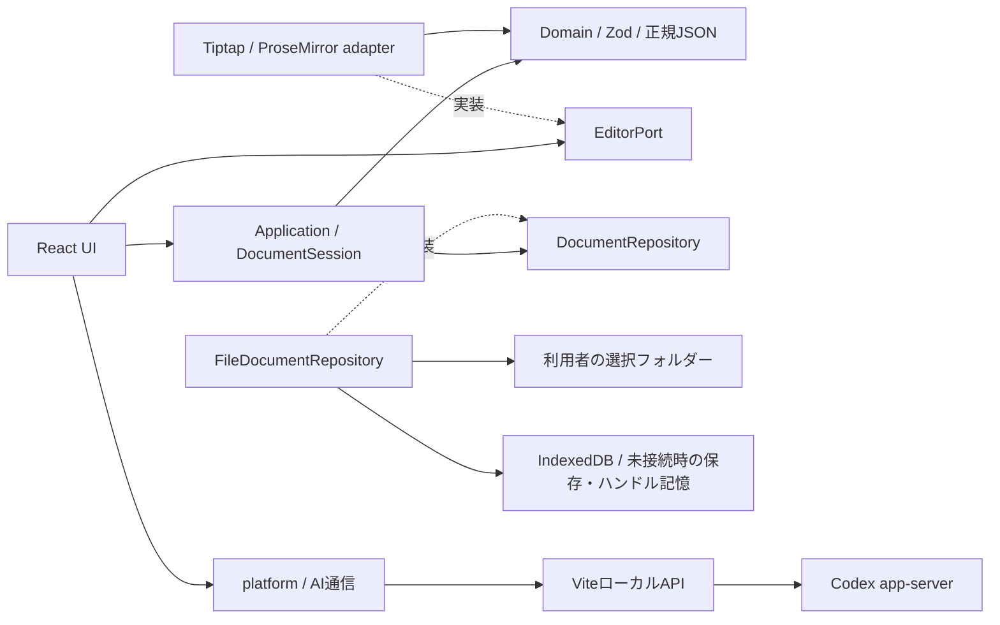

# DocSymbi 基本設計書

更新日: 2026-10-30。対象は本ワークスペースの現行ソース（未コミットの変更を含む）。本書は実装済みの構成を記述し、試験合格や最終受け入れを宣言するものではない。

## 1. 目的と対象範囲

DocSymbiは、構造化文書をブラウザーで閲覧・編集し、利用者のローカルフォルダーに保存するデスクトップ向けWebアプリ/PWAである。正規データは独自の版付きJSONとし、エディター内部JSON・HTMLを保存形式にしない。

| 機能 | 現行の範囲 |
| --- | --- |
| 文書管理 | 一覧、全文検索、種類・タグ・フォルダー絞り込み、並べ替え、新規作成、文書情報編集 |
| 本文 | 段落、見出し1〜6、混在入れ子リスト、コード、画像、表、選択クイズ、太字、リンク |
| 編集支援 | カーソル・選択範囲操作、Undo/Redo、記号自動変換、スラッシュ挿入、画像貼り付け・ドロップ |
| ファイル | 明示保存、取り出し、読み込み、同一IDの明示更新、記事移動・ファイル名変更・削除 |
| フォルダー | 再帰探索、作成、内容を含む改名、確認付き再帰削除、再接続・再走査 |
| オフライン | 準備済みの同一origin・ブラウザープロファイルで起動・編集・保存 |
| AI | ローカルのCodex CLI経由の会話、モデル選択、応答の逐次表示、停止。回答の本文への自動反映はない |

共同編集、クラウド同期、ゴミ箱、関連文書、完成済み設計書テンプレートは未実装。文書種別として基本設計書・詳細設計書を選択できるが、作成本文は空文書である。Claudeは選択肢のみで送信非対応。

## 2. システム構成

`src/main.tsx`がrepository、session、editor、UIを組み立てる。domainはZod以外の外部パッケージやブラウザーAPIに依存せず、applicationはdomainとportを扱う。UIからeditor/infrastructureへの直接importは依存境界検査で禁止する。

React 19、TypeScript strict、Vite 8、Tiptap 3/ProseMirror、Zod 4、Workboxを使用する。正確なバージョンは[package.json](../package.json)とlockfileを参照。実行環境はNode.js 22.12以上23未満、実フォルダー操作はデスクトップChrome/Edgeを対象とする。

静的配信でも文書編集機能を利用できる。AI機能には`npm run dev`または`npm run preview`のローカルAPIとCLIのログインが必要であり、静的配信だけでは動作しない。

## 3. 画面と遷移

ルートURLは文書一覧を表示する。`#article=<UUID>`指定時は保存先にある対象文書をビューモードで開く。存在しない場合は案内を表示する。前回文書IDの記録処理はあるが、現行起動処理はそれを読んで自動再開しない。

| 画面・領域 | 操作・状態 |
| --- | --- |
| 一覧 | 左に実フォルダーツリー、中央に検索・絞り込み・一覧。行の単クリックは選択、ダブルクリックまたはタイトルでEnterは文書を開く |
| 新規作成 | 名前・種類・保存先・タグ・ステータスを指定。初回保存後に編集開始。失敗した下書きは保持 |
| 閲覧・編集 | 左にアウトライン、中央に本文。既存文書は閲覧、新規文書は編集。モード変更は保存を伴わない |
| 右サイドパネル | AIチャットと文書情報のタブ、開閉・幅変更。一覧で選択した文書の情報は読み取り専用 |
| 確認ダイアログ | 未保存移動の保存／破棄／キャンセル、文書・フォルダー削除、名前変更、画像・表・クイズ設定 |

文書名・本文・文書情報の変更は同じセッションの未保存管理対象。保存中や保存失敗時の移動もガードする。ブラウザー終了時の警告は強制終了からの復旧を保証しない。

## 4. データと永続化

1記事を画像本体込みの1個の`.docsymbi.json`に保存する。v1は基本本文、v2は画像、v3は書式・リンク・表・コード言語、v4はクイズに対応する。必要な版へ昇格し、機能を削除しても降格しない。

文書・要素はUUIDで識別する。文書種別・タグ・ステータスは`metadata`、所属フォルダーは実ファイル配置から得る。フォルダーパスを文書JSONへ重複保存しない。未知metadataは保持し、未知の構造キー・未対応版は拒否する。

保存先未選択時はIndexedDBを利用する。フォルダー接続後はその実ファイルを利用し、権限喪失時には再接続を要求する。アクセス失敗を理由にブラウザー内保存へ切り替えない。ブラウザー内記事のコピーは明示操作で、元記事を残して同IDをスキップする。

通常保存は既存ファイル名を維持する。「ファイル名を変更」は文書タイトルと実ファイル名を変更する別操作。文書ID・本文・metadataは保持する。移動・改名はコピーと検証後の元データ削除であり、複数ファイルの原子的な処理ではない。

## 5. 非機能・安全性

- 保存完了は実ファイルの`createWritable().close()`、またはIndexedDB transaction完了後に通知する。保存失敗でも編集状態を保持する。
- 内容ハッシュ由来のrevisionと同一originのWeb Locksで競合を検出・直列化する。外部アプリ／別originとの厳密な排他はない。
- 入力上限は本文・説明情報10 MiB（画像バイト列を除く）、本文100万コードポイント、検証対象要素1万、リスト深さ32。画像のバイト容量にはアプリ独自の上限を設けない（ブラウザのメモリー・保存領域に依存）。持ち運び用JSONは画像込み256 MiB。画像は文書専用の別ファイルとして保存する（[画像保存仕様](image-storage.md)）。性能目標の1,000ブロック・10万文字とは区別する。
- SVGは`img`のdata URLで表示し、本文・metadataを実行可能HTMLとして挿入しない。コードブロックは実行しない。
- 通常の編集・保存で文書を外部送信しない。AI送信時は現在文書のテキスト・構造・metadataを共有し、画像バイト列は除く。AI会話は揮発状態である。
- Service Workerはアプリ資産を事前キャッシュする。更新は利用者操作と未保存確認を経て適用する。AI応答はオフライン利用の対象外。

## 6. 検証と参照

詳細な処理・API・ソース対応は[詳細設計書](detailed-design.md)、データ仕様は[文書形式](document-format.md)を参照。Vitestがdomain/application/codec/adapter、Playwrightがrepository統合・オンライン／オフラインUI・性能を検証する。現行の試験定義は[tests](../tests)、過去の結果と手動受け入れの残件は[validation](../specs/001-structured-editor-mvp/validation/acceptance.md)に分けて管理する。
